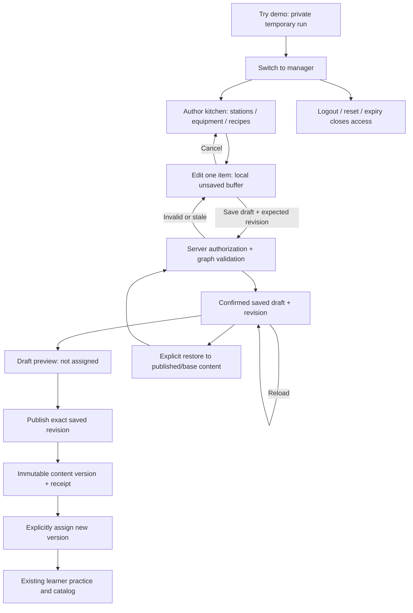
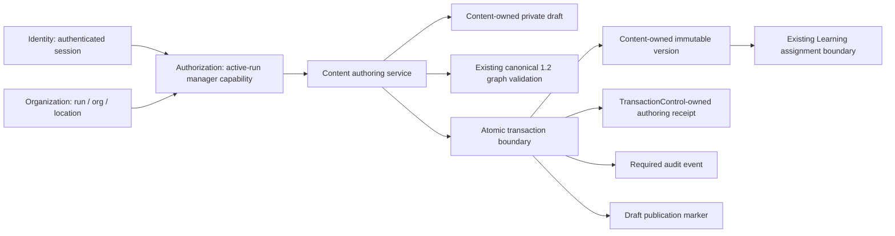

<!--tos-doc
{
  "doc_id": "TEACH-DEMO-AUTHORING-FOUNDATION",
  "class": "source-record",
  "version": "0.1.0",
  "claims_truth_state": "declared",
  "status": "proposed",
  "owner": "Patrick Craven, Top Shelf Service LLC",
  "created_on": "2026-10-26",
  "updated_on": "2026-10-26"
}
-->

# Manager authoring: one complete path, not a CMS

## Status and scope

This is the next increment after the [released read-only kitchen foundation](demo-kitchen-foundation.md). Product scope is approved; this document is not proof that implementation, permissions, database migration or deployment has completed. Release evidence must identify the exact reviewed source, migration readback, required CI and live acceptance. Historical proposal records remain historical.

The goal is a manager adding a station, equipment item and recipe; saving and reopening a private draft; previewing and publishing an immutable version; then explicitly assigning that version. The learner sees published assigned content, never drafts. Earlier training history remains unchanged.

### Must

- Manager-only, server-authorized add/edit operations within the current content bounds. Learner and other-visit direct requests are denied.
- Recipes reference stable station and equipment IDs. Station responsibilities select an existing fictional cook; people remain display-only, not real staff accounts. Recipe requirements and sample holdings are separate values.
- Real drafts survive refresh **during the same demo visit**, including switching back to the same manager persona. They are inaccessible after run closure/expiry. No cross-visit workspace or physical-deletion promise.
- Useful names, bounded quantities and valid references. Referenced values cannot be removed silently. Stale revisions fail rather than overwrite newer saved edits.
- Saved draft preview, atomic immutable publication, separate explicit assignment. No training questions, expected answers, scoring or existing attempts are editable.
- Honest pending/confirmed/failed states, duplicate protection and authoritative recovery after an uncertain response. Cancel/discard and unsaved navigation are explicit.
- Labelled, keyboard-usable forms and responsive layout. Actual device evidence remains distinct from unit tests.

### Should, after the complete path

Duplicate a sample recipe, authoring search/filter, concise change summary, guided walkthrough and visible limits.

### Not in this increment

No recipe images/rich formatting, visual graph editor or other optional polish until justified. No real staff accounts/onboarding/scheduling, stock transactions, purchasing, reservations, maintenance, AI assessments, recipe scoring, multi-editor collaboration, approval chains, bulk imports or full CMS.

## Workflow map

Navigating away from an unsaved form requires an explicit decision. A pending write is not a saved result. Reset must close the old run successfully before beginning a replacement; an unknown close never starts another run. New assignments must not silently switch an existing active attempt to different content.

## Ownership and persistence map

Draft metadata is separate from published content: immutable owner/run/base reference, optimistic revision, confirmed draft digest and publication reference. The client submits only editable kitchen data, never training blocks, answers, identity, ownership or the fictional people set. Server-side composition retains those unchanged values from the bound base.

Current schema1.2 already supports1–12 stations,1–24 recipes,1–24 fictional people,1–40 equipment types and1–80 holdings. Authoring does not require a new published schema merely to add values. The demo retains its fixed three training blocks. Existing assignment limits remain separate from authoring limits.

The proposed private storage extension uses a Content-owned draft table and an append-only TransactionControl-owned authoring receipt table. Runtime database rights are limited to draft SELECT/INSERT/UPDATE and receipt SELECT/INSERT, with no DELETE or public/anonymous access. Database role policy alone is **not** per-visit isolation: authenticated server context, scoped predicates, composite bindings, guards and expiry fences enforce that boundary. No manager receives an automation publisher identity.

Save and publish receipts bind run, manager, operation, key and payload digest. Publication inserts the new version, audit, receipt and draft marker atomically. Repeating a published revision cannot allocate another version. Successful retries/no-op publication do not consume additional caps. A saved draft equal to the latest published business content returns that existing version with an explicit unchanged result; restoring different older content can deliberately publish a new immutable version. The scoped limits are 100 saved changes and 10 new publications per visit, with 256 operation-receipt keys; the existing 10-assignment limit remains independently visible.

## Acceptance matrix

| Proof | Required result |
| --- | --- |
| Add station + equipment + recipe | Stable linked IDs; existing fictional cook selection; requirements distinct from holdings |
| Save → refresh → manager return | Same confirmed draft/revision survives during this run; no browser-only saved claim |
| Preview → publish → readback | Preview clearly draft; one immutable version; one matching atomic receipt/audit |
| Explicit assignment | Learner sees new assigned version; no draft or unassigned version disclosure |
| Existing active/completed attempts | Original version/digest, responses and completion timestamps unchanged |
| Invalid/stale/forged writes | Field errors or bounded denial; no overwrite, cross-run effect or partial publication |
| Duplicate and uncertain responses | Stable operation readback; same result or explicit unresolved state, never assumed success |
| Cancel/discard/navigation | Local cancel preserves saved draft; explicit restore uses revision checks; dirty state is not silently lost |
| Reset/logout/expiry | Authoring access revoked with run; clean new sample on confirmed reset; old publication/history retained |
| Keyboard/mobile | Labels, focus/error handling and responsive layout checked; unsupported device/screen-reader evidence identified |
| Existing demo regression | Original learner → saved result → manager → repeat → reset → logout still works |

## Release order and rollback boundary

Prepare the exact additive schema, permission and route successor; review its ownership and least-privilege impact; obtain the specific reserved production authorization; test locally and pass all required exact-head checks. Apply only the reviewed migration with predecessor/readback evidence, then deploy and verify the complete live flow. Never rewrite old migration bytes or weaken admission to make the increment pass.

Published schema1.2 versions remain valid without authoring. Rolling back new authoring code must not erase published versions or draft/receipt history. Do not guess a destructive schema rollback or remove guards/grants while requests may still use them; require a separately reviewed operational plan.

## Walkthrough

Try demo → Switch to manager → Author kitchen → add a station, equipment item and linked recipe → Save draft → reload → Preview → Publish → Assign new version → Switch to learner. Confirm the new catalog and keep an older training assignment open to demonstrate that its version does not change. End with Reset Cancel/Confirm or Sign out.
