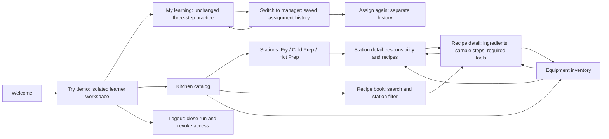
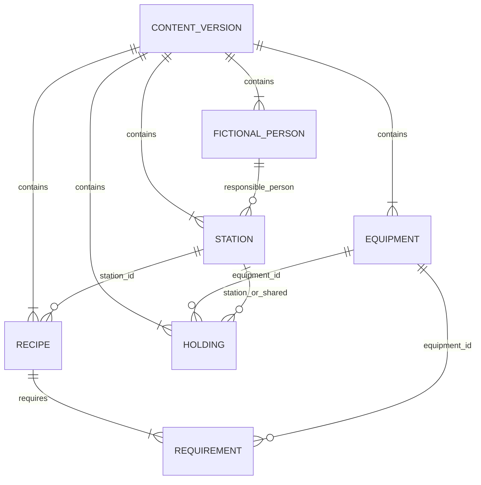

<!--tos-doc
{
  "doc_id": "TEACH-DEMO-KITCHEN-FOUNDATION",
  "class": "source-record",
  "version": "0.1.0",
  "claims_truth_state": "declared",
  "status": "proposed",
  "owner": "Patrick Craven, Top Shelf Service LLC",
  "created_on": "2026-10-26",
  "updated_on": "2026-10-26"
}
-->

# Small kitchen demo: one connected reference model

## Scope and release status

This local candidate adds **Stations**, linked fictional responsibilities, recipe tool requirements and a compact equipment inventory to the existing demo. It is a foundation for later work, not an operations system. It is not deployed merely because source tests pass.

The owner requested this extension and a final acceptance batch on 2026-10-26 at 01:30:23 UTC. Preparation and local tests were authorized with the request. At 01:45 UTC the owner also approved publication, review-gated merge/deployment and the tested production content-guard migration. SYS-21 issue #99 records the bounded impact. Passing exact-source review and release checks still precede execution; approval is not migration or deployment evidence. Historical approvals are not reused for this successor.

The initial sample is deliberately small:

| Station | Fictional responsibility | Sample recipe |
| --- | --- | --- |
| Fry | Casey — fry cook | Potato wedges |
| Cold Prep | Morgan — cold prep cook | Garden slaw |
| Hot Prep | Sam — hot prep cook | Vegetable soup |

Eight tool/equipment types are shared by these references. The sample is not a cooking procedure or food-safety guide. People are display-only characters, **not** the Alex/Jordan authentication identities. Quantities are fictional holdings, never measured stock, availability, reservations or maintenance status.

## Navigation map

These are client views over the existing assigned-content read, not new API routes. Stations and inventory retain the learner's existing `ReadAssignedContentVersion` capability. Managers can switch to learner to browse; no permission is added.

## Logical model and source of truth

All values belong to **one immutable ContentPack version**, rather than new database tables or auth entities. IDs are stable within that pack/version. UI detail keys also include the scoped assignment reference; labels and array positions are never used as identity. Reassignment of the same pack/version deduplicates reference pages and links practice to the latest assignment, preserving older completion records.

- A station references exactly one fictional responsible person.
- A recipe references a station and lists equipment requirements with quantities.
- Inventory holdings reference equipment plus a station, or `null` for the shared kitchen.
- Holdings and recipe requirements are distinct. Showing tongs in two recipes does not double the recorded inventory.
- Unique IDs, unique holding locations and requirement IDs, bounded positive integer quantities and all references are validated. Unknown references fail closed.
- The browser obtains catalog data only from the service. `tests/demo-web/station-fixtures.mjs` is a test-only projection of the canonical synthetic template; it is not served.

Canonical schema and sample: `domains/demo-kitchen/proposal-0.1.0/`. Schema `1.2.0` is a strict successor. The original `1.0.0` and `1.1.0` content, factories and schema files remain intact. Old assignments continue reading their own exact version; the UI does not fabricate people or equipment for old content. New runs receive the new sample only after the complete successor is released.

The three original training blocks, expected answers, scoring engine and manager privacy projection are unchanged. Browsing a station, recipe or equipment page does not start a session, record a response or mark mastery.

## Deliberate exclusions

No staff/account CRUD, scheduling, shifts, stock adjustments, reservations, purchasing, supplier integration, maintenance records, recipe-specific scoring, media uploads or ingredient inventory. No new grants, authentication flows, browser storage, external assets, route inventory or database tables. The equipment list is small by design; a future search/filter can be added if its size justifies it.

## Required deployment sequence

1. Review the exact canonical/public schema, seed, graph validator, UI, test evidence and narrow SQL guard successor.
2. Complete the repository's real successor registration and independent review; preserve historical seals and predecessor proofs. Do not silence a failing gate or mislabel a proposal as admitted.
3. Confirm the recorded production migration authorization and exact target. Apply only the approved content-validation function replacement in the isolated demo namespace, with unchanged tables, grants, triggers and old-version behavior. Existing rows are not rewritten.
4. Verify the applied guard and unchanged old content; then deploy the exact approved code revision through the required checks.
5. Run a fresh end-to-end demo through the canonical URL. Confirm stations/people/recipes/equipment links and unchanged training, manager readback, repeat, reset and logout. Old immutable deployment URLs do not change.

A guard-only rollback to the old validator must not be guessed after new `1.2.0` rows exist. Stop new admission and review compatibility first. The release is incomplete until application, guard and actual deployed revision agree.

## Five-minute walkthrough

1. **Try demo**, then open **Stations**. See the three fictional responsibilities.
2. Open **Fry**, then **Potato wedges**. Follow the station link back and inspect its required equipment.
3. Open **Tongs**. Compare its shared holding count with the two separate recipe requirements; no availability claim is made.
4. Open **Recipe book**. Search, filter by station, clear filters and refresh. No learning response should be created.
5. Open the existing handoff practice, save all three responses and complete it. Switch to manager and reload the history.
6. **Assign again** to demonstrate an independent history. **Reset demo** supports Cancel (no change) and Confirm (closes old run before starting a new workspace). **Logout** closes access; retained synthetic records are not described as deleted.

## Evidence checkpoint — 2026-10-26

### Released baseline only

Baseline `884d829e5b53dcf9291677f52e7f100882f528e6`, tree `5b0e25d95320e712d7fb112852cfe29f085f895e`, at `https://teach-v2.vercel.app/` passed a live synthetic acceptance batch at 01:39 UTC:

- Credential-free admission; two separate assignments completed with three saved responses each; manager reload preserved both completion timestamps.
- Reset Cancel preserved IDs and timestamps. Confirm closed the old run and created a fresh workspace with one assignment and zero responses.
- All three legacy recipe pages, search/no-results/clear, station filter, refresh and navigation worked without learning writes.
- Logout survived original/second-tab reload and Back/Forward. Scoped read-only database confirmation showed both synthetic runs `CLOSED / USER_EXIT`.

This evidence **does not verify the new station extension**. Independent-browser context isolation, mobile viewport and injected network failures were not tested live because the supported browser controls do not expose those operations. A second tab is not an independent browser context.

### Local candidate only

The new UI/API unit suite covers exact schema copies, strict old/new wire shapes, graph references, stable scoped keys, deduplication, shared holdings, read-only navigation, stale-state clearing, role boundaries, escaping and focus intent. A DOM event stub is not proof of actual keyboard accessibility or layout.

Disposable local PostgreSQL tests cover the strict successor against accepted new content, rejected malformed graphs, byte-identical legacy rows and unchanged tables, grants, triggers and function identity. This is not production migration evidence.

Automated source checks, live baseline checks, new-feature browser checks and production state remain separate claims. Do not present the demo as fully mobile/screen-reader certified without those tests.
