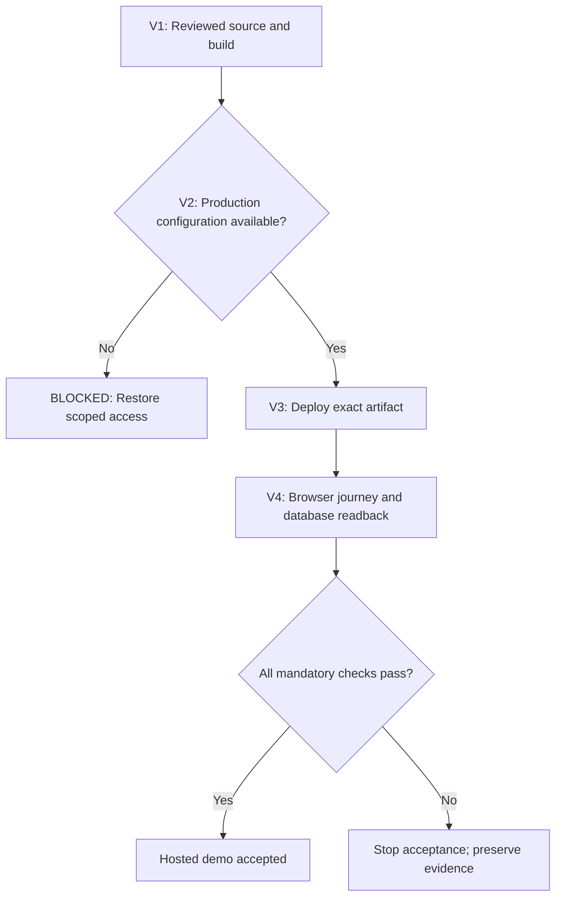

# Vercel hosted-demo continuation — 22 October 2026

Owner instruction: finish the hosted demo, then switch its release target from
Netlify back to the existing Vercel project. This authorizes the requested
implementation and release work; historical preparation-only labels do not
reopen that owner decision. No spending or broader database privileges are
part of this work.

## Identity and observed state

- Repository baseline: `61c0425486584f70560599232bcd916e6ec1d472`,
  tree `7341dcdbef541ddea68e24f825b0a9b4d9bd9a5c`.
- Tested code: local commit `d1877b910daa478b2b70ab1a737343087f72ff58`,
  tree `c2839b756ad090f3354399543a097ddb9be5f6e4`.
  This checkpoint adds documentation after that code verification.
- Vercel team: `team_aS49zdHR7qLMaINmq7c87aA4` (`peteyweetss`).
- Existing Vercel project: `prj_7CxcK2nq2pM52yHum3OBgB6C1shq`
  (`teach-v2`), Node `24.x`; authenticated readback showed no deployments.
- Supabase: existing `t34ch`, `acqafjkdkdmtpnsxiesw`, PostgreSQL 17.
  The `teach_v2_demo` namespace already has 22 application tables and its
  migration journal. All seven ordered journal hashes/timestamps match
  `drizzle-isolated/manifest.json`; no installation or replay was attempted.
- Catalog readback: all demo tables have RLS enabled; the runtime role is LOGIN,
  NOINHERIT, NOSUPERUSER, NOBYPASSRLS, NOCREATEDB and NOCREATEROLE. It has demo
  schema USAGE, no schema CREATE and no journal SELECT. Both named API roles
  lack demo-schema USAGE. These catalog checks do not substitute for actual
  runtime-login, TLS, provider Data API exclusion or end-to-end acceptance.

## Implementation and verification

The three-file code change adds `vercel.json`, ignores generated `.vercel/`
output, and adds `scripts/packaging/build-vercel-release.mjs`. The wrapper
builds the existing opt-in Node accepting artifact in a new temporary directory,
then publishes it to `.vercel/output`. It rejects existing output and preserves
the existing clean-source, pinned-tool, Node-patch, origin, TLS and configuration
checks. No application, authorization, transaction, migration or dependency
versions changed.

Local checks on the tested code above:

| Criterion | Result | Evidence |
| --- | --- | --- |
| Full TypeScript check | PASS | `pnpm exec tsc --noEmit` |
| Hosted and successor tests | PASS | 47 passed, zero failed |
| Actual release build | PASS | 2,889 files; Node 24.19.0; pnpm 12.8.1 |
| Complete packaged-file hashes | PASS | All 2,889 accepting-manifest hashes matched |
| Catchall and launcher identity | PASS | Build Output API v3; existing Node accepting entrypoint |
| Missing configuration | PASS | Packaged handler returned generic 503 |
| Existing output | PASS | A second build rejected reuse before mutation |
| Packaged application journey | PASS | Synthetic-memory proof: 15 operations and seven assets |
| Exact published-head CI/review | UNKNOWN | Must bind checks and review to the published revision |
| Hosted configuration and deployment | BLOCKED | Vercel environment API returned 403 |
| Hosted browser/database journey | BLOCKED | Requires configured deployment |

No live deployment, runtime credential change, database mutation, security-setting
change, Netlify branch update or spending occurred in this continuation. The
local artifact is verification output, not provider proof. Existing Vercel
deployment protection remains in place.

## Current blocker and next action

The connected Vercel account can inspect the project and deployments, but
`GET /v10/projects/{id}/env` returned 403. The mapped CLI fallback found no
existing credentials; its unfinished device-login flow was stopped. Do not
retrieve the Netlify password, create an admin database login, weaken TLS or
deployment protection, or use another project's credentials to bypass this.

Restore narrowly scoped Vercel environment access or use an owner-approved
dashboard fallback. Verify the existing project's nonsecret pooler endpoint,
CA and origin, then configure the seven fields required by
`src/bootstrap/demo-successor/runtime-config.ts`. Store the restricted runtime
password as a Production Secret; preview builds must not receive it. Reconcile
credential provisioning separately, without displaying a secret.

After exact-source CI, scope and review checks pass, deploy the accepting artifact
to this existing project. Verify build/runtime Node patch equality, secure
session cookies, the complete learner/manager/reset journey, negative authority
and cross-run isolation, and authoritative database readback. Any failed or
unknown mandatory criterion keeps hosted acceptance incomplete.

## Planned visual map

### Continuation — 23 October 2026

Authenticated Git deployment context now confirms that the existing Vercel
project is linked to `peteywee/teach-v2`. The project-domain endpoint separately
verifies `teach-v2.vercel.app`; the deployment list is still empty. The summary
project endpoint's empty `domains` array was incomplete and must not override
that more specific domain evidence.

Patrick reported saving the three fixed target variables and the restricted
runtime password in his own authenticated dashboard. Instructions scoped all
variables to Production and the password to Secret. He supplied the pooler
hostname `aws-1-us-east-2.pooler.supabase.com` and the Supabase Root 2021 CA.
The certificate parses, expires 26 April 2031, and has SHA-256 fingerprint
`807025ad50d4ed219d2c9c7d299c004f824eb00cf7f65afef607d07b72e6cafa`.
These are operator declarations and certificate parsing, not provider variable
readback or an actual TLS/database connection. The last supplied variable was
`TEACH_DEMO_ORIGIN=https://teach-v2.vercel.app`; its save is unconfirmed.
No secret was received, retrieved or included in source.

Exact-head CI at `96d71d1febfac64d538d8ec00a682175ede47e15` failed:
run `39794459729`, authority stage, 25-second timeout. The original umbrella
performed the complete repository integration inspection before discovery,
then ran that same inspection again through its standalone validator.
The small successor removes the first duplicate inspection, explicitly
requires the standalone integration validator, and retains all 58 validators,
each validator's five-second ceiling, and the outer 25-second ceiling.
No sealed test, review, registration, workflow or timeout is changed.

Local verification of the revised umbrella, SHA-256
`218ed200c58ff706edf315a5d9971b0bb6559bd41b60571164d163a3411a7e48`:

| Criterion | Result | Evidence |
| --- | --- | --- |
| Complete authority umbrella, Node 24.19.0 | PASS | All 58 validators; 22,150 ms |
| Complete authority umbrella, CI's Node 20.20.2 | PASS | All 58 validators; 22,683 ms |
| Existing unchanged physical-validator regression | PASS | One selected test; five-second bound and failure propagation |
| Missing integration validator | PASS | Actual umbrella in VM rejects absent slot; 57 other validators retained |
| Failed integration validator | PASS | Actual umbrella in VM propagates failure; all 58 invoked, integration once |
| Diff whitespace | PASS | `git diff --check` |
| New exact-head hosted CI | UNKNOWN | Must run after publication; local timing is not hosted acceptance |
| Review-thread audit | PASS | No unresolved threads at the observed prior head; not independent approval |
| Live browser/database acceptance | BLOCKED | No deployment exists |

An earlier read-only compile-cache experiment also completed the old umbrella
under Node 24. It is not the submitted fix: CI uses Node 20, and the successor
does not enable a compile cache or reuse validation results. The previous
parallel candidate remains unsubmitted. No efficiency percentage is claimed.

Next: publish this bounded fix to PR #93, reconcile exact-head CI and source
scope/review threads, finish Production configuration, then release and perform
the existing browser-to-database acceptance checks. Do not infer live behavior
from repository linkage, local checks or an untested deployment.

## Logical map

| Step | Condition and actor | Permitted action | Evidence or recovery |
| --- | --- | --- | --- |
| V1 | Operator has the exact reviewed source | Build and verify its package | Exact source/tree, file hashes, checks and review |
| V2 | Scoped Vercel access and target identity verified | Configure Production only | Metadata readback; stop on 403 or unknown target |
| V3 | Required fields, release checks and runtime credential ready | Deploy the exact artifact | Deployment/project/source identity and runtime patch |
| V4 | Deployment ready and runtime checks agree | Run bounded browser and persistence checks | Full journey, secure cookies and authoritative readback; preserve failures |

Resource comparison: baseline and exact token/cost telemetry UNAVAILABLE. No
efficiency savings are claimed. This is a hosted-demo continuation, not proof
of a real restaurant pilot, second-restaurant portability or commercial readiness.
